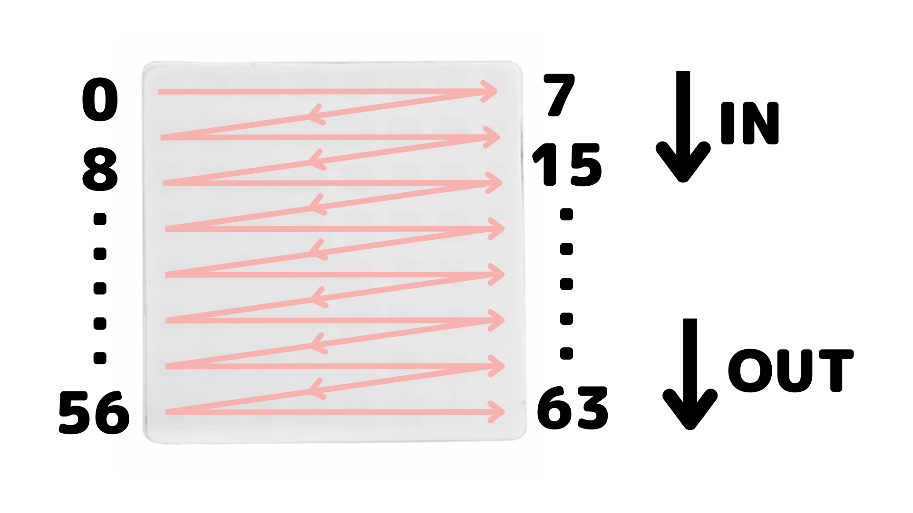
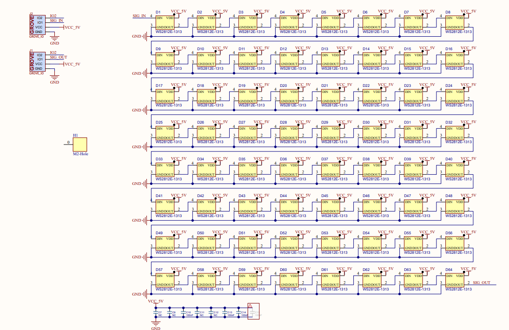

## 需求

1. 目前我在 GPIO22 上链接了一个 WS2812 灯珠矩阵，顺序排布和原理图如下，请先理解这个硬件设计，以及控制方法

2. 请调查 FastLED 库是否可以在当前 ESP-IDF 工程下适用，如果可以，请作为 submodule 用于控制 esp32p4 的 ws2812 灯珠矩阵，https://github.com/FastLED/FastLED
3. 我需要在触摸按键时，通过 ws2812 灯珠矩阵显示不同的数字和颜色

## 自主迭代

* IDF_PATH 为 /home/libo/esp/gitlab_release_v5_5
* target 为 esp32p4，当前端口是 /dev/ttyACM0

